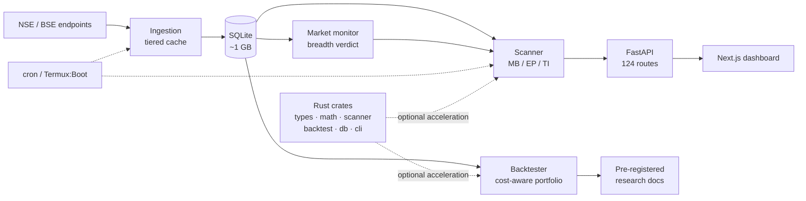

# Dhanustambha — a reproducible market-research platform

**Private source · public engineering write-up.** Dhanustambha (धनुस्तंभ, "the arrow at full draw") is a personal platform for systematic equities research on NSE/BSE data. The code stays private because it contains live strategy parameters and research notes; this document covers the engineering, which is the interesting part.

> Personal research project. Not investment advice. Built on my own hardware, in my own time, with no employer code, data, or infrastructure. No client or brokerage data is involved.

---

## What it actually does

Five layers, each one useful on its own:

1. **Ingestion** — NSE EOD OHLCV for the full listed universe, plus a live LTP/OHLCV path for intraday checks. Tiered caching so a full-universe scan does not re-download history.
2. **Market monitor** — breadth engine over the universe that emits an Offensive/Defensive market verdict; scans are gated on it.
3. **Setup scanner** — momentum-burst, episodic-pivot and trend-intensity screens, each with entry-quality buckets and a deduplication pass so one symbol yields one row.
4. **Trade management** — position sizing from account risk, open-trade log, P&L, stop management including entry-day handling.
5. **Review loop** — trade journal, per-setup analytics, and a cost-aware portfolio backtester with pre-registered hypotheses.

A Next.js dashboard sits on top of the FastAPI service; a scheduler runs the morning briefing after market close.

## Scale

| Metric | Value |
|---|---|
| Commits | 799 (Apr 2026 → Nov 2026) |
| Tracked files | 1,114 |
| Total tracked lines | 200,896 |
| Python | 486 modules · 119,186 lines |
| TypeScript / React | 136 files · 37,071 lines |
| Rust | 12 files · 4,597 lines (7-crate workspace, partial migration) |
| Design/research docs | 191 markdown files |
| HTTP routes | 124 (FastAPI) |
| Test modules | 120 `pytest` files |
| Primary store | SQLite, ~1 GB |

## Architecture

## Design decisions worth defending

**SQLite instead of Postgres.** The workload is one writer (the nightly job) and many readers (scanner, dashboard, backtests). A single file on a phone or a WSL2 box removes an entire service from the ops surface, and 1 GB of EOD bars is well inside comfortable range. The cost is acknowledged: no concurrent writers, and the schema is designed around that.

**Costs and slippage are first-class.** Every backtest result comes out of a portfolio-level simulation with per-trade costs, not a sum of per-trade returns. Research docs record the assumptions, and hypotheses are written down before the run — several were rejected on that basis.

**Corporate actions are normalized on read.** Splits and bonuses are back-adjusted inside the data-access layer, so live scans, backtests, charts and one-off studies cannot silently disagree about history. This was a bug class, not a feature.

**Rust is an optional path, not a rewrite.** The `dhanu_core` extension is imported from Python behind a guarded import; if it is absent the pure-Python implementation runs. That keeps a single reference implementation while the hot loops move over, and it means the system never depends on a half-finished migration.

**Docs are part of the product.** `AGENTS.md` and `AGENT_RULES.md` exist because the project is built incrementally across many sessions with AI assistance: architecture, decisions, plans and progress are files in the repo, not context in someone's head. 191 markdown documents is the result, and it is the reason the work is resumable.

## Test strategy

120 `pytest` modules, weighted toward the places where silent wrongness is expensive: indicator math, breadth thresholds, deduplication priority, entry-quality bucketing, corporate-action adjustment, portfolio accounting, and API contracts. Regression tests are added against discovered bugs — e.g. entry-day handling and stop evaluation for open positions.

## Operations

Runs at zero infrastructure cost on either WSL2 (HP laptop) or Termux on a rooted Android phone: `cron`/`Termux:Boot` triggers ingestion after close, the API runs under a process manager, and the dashboard is reachable on the LAN. Nothing is hosted on a paid cloud.

## What I'd change

- The Python core is 119k lines and the Rust workspace covers only a handful of hot paths (4.6k lines); the honest version is that the boundary should have been drawn before the second scanner existed.
- Some research scripts still live outside the package and import internal modules; that makes refactoring expensive.
- SQLite is right for this workload, but the backtester's read pattern (full-history scans) would benefit from a columnar sidecar.

## Why the source is private

Live strategy parameters, position sizing rules and unpublished research are in the repo, and publishing them would make the project worse at its job. The engineering is what I want to show; I'm happy to walk through the architecture or the backtest harness on a call.

---

*Built by [Gajanan Kadtan](https://github.com/The-kadtan2027).*
